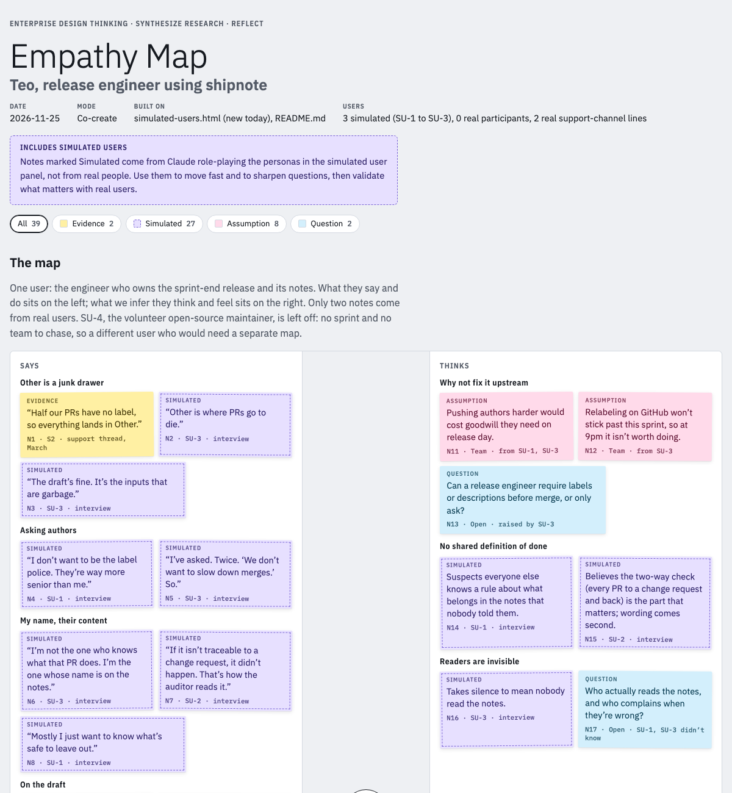

# IBM Design Thinking marketplace for Claude Code

This [Claude Code](https://code.claude.com) plugin marketplace turns [IBM Enterprise Design Thinking](https://www.ibm.com/training/enterprise-design-thinking/framework) into skills. It covers the framework (the Principles, the Loop and the Keys) and all 29 activities in the [EDT toolkit](https://www.ibm.com/training/enterprise-design-thinking/toolkit).

**[Browse the skills](https://barvhaim.github.io/ibm-design-thinking-marketplace/)**: the docs site has a page for every skill, covering its steps, the live-session kit, the page it produces and its quality checks.

## How it works

- **Simulated users.** You don't need research access to start. When an activity needs users, Claude builds a panel of distinct simulated personas (`/edt-core:simulated-users`), including skeptics and edge cases. It then interviews, observes and tests with those personas in character. Real research you provide always comes first. Everything a simulated user produces stays labeled *Simulated*, so the team can see what still needs a real user.
- **HTML artifacts.** Every activity produces an HTML page in `design-thinking/`, laid out like a workshop wall: sticky notes color-coded Evidence, Simulated, Assumption or Question, with a filter for each tag. When your Claude Code session supports artifacts, the page is also published as an artifact you can share. Each page embeds a JSON data block that the next activity reads, so `/edt-synthesize:needs-statements` builds on your empathy maps, and `/edt-plan:hills` builds on your needs statements.
- **Two modes.** *Co-create* (the default): Claude runs the activity with you. *Facilitate*: add `facilitate` to the command, and Claude prepares a kit page for a live team session, with an agenda, prompts to read aloud and an empty board. Afterwards, Claude turns photos of the wall into the results page.

## Example output

`shipnote` is a fictional CLI whose repo holds nothing but a README. One command, `/edt-synthesize:empathy-map release engineer using shipnote`, produced this empathy map and the simulated users panel it drew on. Neither page was edited.

<a href="https://barvhaim.github.io/ibm-design-thinking-marketplace/examples/shipnote/empathy-map-release-engineer.html">
  <picture>
    <source media="(prefers-color-scheme: dark)" srcset="assets/screenshots/empathy-map-dark.png">
    
  </picture>
</a>

Only 2 of the map's 39 notes come from real sources, and the page says so: Evidence notes are yellow, Simulated notes are purple with a dashed edge, Assumptions are pink and Questions are blue. Open the live pages, the [empathy map](https://barvhaim.github.io/ibm-design-thinking-marketplace/examples/shipnote/empathy-map-release-engineer.html) and the [simulated users panel](https://barvhaim.github.io/ibm-design-thinking-marketplace/examples/shipnote/simulated-users.html), or see their source in [`examples/`](examples/).

## Install

```bash
claude plugin marketplace add barvhaim/ibm-design-thinking-marketplace

# Install the framework guide first, then the activity plugins you want:
claude plugin install edt-core@ibm-design-thinking
claude plugin install edt-synthesize@ibm-design-thinking
```

Or install all eight plugins at once:

```bash
for p in core gather synthesize plan ideate test align ai; do
  claude plugin install "edt-$p@ibm-design-thinking"
done
```

You can also browse and install from inside a session with `/plugin`.

## Plugins

| Plugin | Skills |
| --- | --- |
| **edt-core**: the framework | `guide` · `simulated-users` · `sponsor-users` · `workshop-planner` · `practice-check` |
| **edt-gather**: gather user data | `contextual-inquiry` · `interviews` |
| **edt-synthesize**: synthesize research | `empathy-map` · `as-is-scenario-map` · `needs-statements` · `stakeholder-map` |
| **edt-plan**: plan your work | `hills` · `assumptions-and-questions` · `prioritization-grid` · `experience-based-roadmap` · `research-plan` · `user-stories` |
| **edt-ideate**: generate new ideas | `big-idea-vignettes` · `to-be-scenario-map` · `storyboards` · `speculative-design-stories` |
| **edt-test**: test your ideas | `feedback-grid` · `cognitive-walkthrough` · `paper-prototypes` · `wireframes` |
| **edt-align**: align your team | `playbacks` · `hopes-and-fears` · `daily-syncs` · `retrospectives` |
| **edt-ai**: AI Essentials | `intent` · `data` · `understanding` · `reasoning` · `knowledge` |

You run a skill as `/<plugin>:<skill>`, for example `/edt-plan:hills`. You don't have to call skills by name, though. Claude also picks the right one when you describe what you need, for example "help me turn these interview notes into an empathy map".

## Where to start

```
/edt-core:guide we're kicking off a new onboarding experience for data scientists
```

The guide works out where you are in the Loop, checks which Keys you're missing and how much rests on simulated users, and recommends the next 1–3 activities.

Common paths:

- **Start without users:** `simulated-users` → `interviews` → `empathy-map`
- **From research to intent:** `empathy-map` → `as-is-scenario-map` → `needs-statements` → `hills` → `playbacks`
- **From intent to concept:** `big-idea-vignettes` → `prioritization-grid` → `to-be-scenario-map` → `storyboards`
- **Test:** `paper-prototypes` or `wireframes` → `cognitive-walkthrough` → `feedback-grid`
- **Delivery:** `experience-based-roadmap` → `user-stories`

## Develop

```bash
claude plugin validate .                      # validate the marketplace and every plugin
claude plugin marketplace add ./              # test locally
claude plugin install edt-core@ibm-design-thinking
```

Run `/reload-plugins` in a session to pick up your edits. The page template and the simulation protocol live in `shared/`. Edit them there, then run `scripts/sync-shared.sh` to copy them into every plugin. For skill conventions and the SKILL.md template, see [CONTRIBUTING.md](CONTRIBUTING.md).

The docs site is generated from the SKILL.md files and deployed to GitHub Pages by `.github/workflows/pages.yml` on every push to `master`. To preview it locally:

```bash
pip install markdown-it-py==3.0.0
python3 scripts/build-site.py              # writes _site/
python3 -m http.server -d _site 8000       # open http://localhost:8000
```

## Attribution

Enterprise Design Thinking, its framework and its toolkit are © IBM Corporation. These skills paraphrase IBM's public materials and link to the original toolkit decks.

The skill files in this repository are licensed under [Apache-2.0](LICENSE). That license does not cover IBM's toolkit materials, which remain IBM's.
