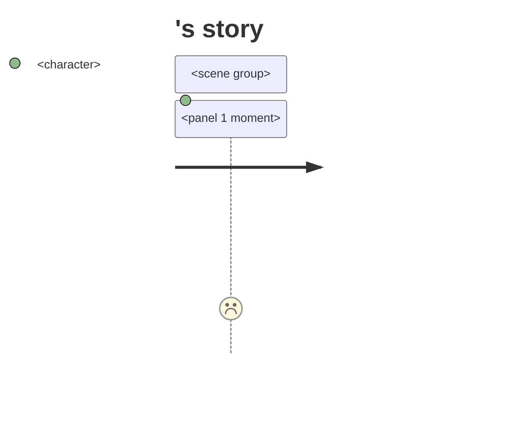

# Storyboards

> IBM Enterprise Design Thinking · Generate new ideas · Make · ~20 min

Stories help people understand intuitively how an idea fits into a user's world, and giving a story visual form makes it easier for others to grasp, critique and build on. A storyboard is a comic strip of the user's future: a character, a setting, a plot and a handful of scenes. Drawing skill doesn't matter, because stick figures and speech bubbles are enough. Claude can't draw on paper, so it writes a frame-by-frame script and, if you want one, a rough sketch the team can redraw by hand.

## When to use it
- You know the problem and the user, and you have one or more candidate ideas, for example from Big Idea Vignettes.
- To share a vision of the user's future quickly in a Playback or with Sponsor Users.
- To expose an idea's assumptions, because drawing the story forces you to decide what actually happens.
- To compare ideas: storyboard two or three alternatives, then converge on a shared vision.

## Inputs
- Upstream artifacts in `design-thinking/`: `big-idea-vignettes-*`, `to-be-scenario-map-*` (a strong spine for the story), `needs-statements-*`, `hills-*` and `empathy-map-*` (to ground the character).
- If missing, ask who the character is (role and context), what problem they face and which idea we're showing. If the problem and the user aren't known yet, it's too early. Suggest `/edt-synthesize:needs-statements` or `/edt-synthesize:empathy-map` first.

## Co-create with Claude
1. **Gather context.** Create `design-thinking/` if missing, list it, and read the upstream artifacts. Name the need the story addresses and give its source.
2. **Identify the story.** Propose three elements:
   - **Character:** the real target user, grounded in an empathy map or a Sponsor User. Use an invented persona only if the user asks, and label it hypothetical.
   - **Setting:** where and when the story happens, and what's around the character.
   - **Plot:** the problem, then the moment the character encounters the idea, then the outcome.
3. **Diverge on storylines first.** Offer two or three one-line storylines before detailing any of them. Vary the idea, first use versus repeat use, or a stressful edge case. Let the user choose one, or rough out all of them. Don't polish one favorite before the alternatives are on the table.
4. **Pick the scenes.** Choose 4–8 panels that show the plot developing from start to finish. Include the major events: a shift in setting, a new character arriving, or a plot twist where something goes wrong. A useful spine is: context, trigger or problem, meeting the idea, using it, payoff, new normal. Start before the idea appears, so the problem is visible in the user's life.
5. **Write the panels like a comic strip.** For each panel, give:
   - what we see (directions for the sketch)
   - a speech bubble and a thought bubble
   - a caption or narration
   - an action burst for key moments ("BUZZ!", "Done.")

   Show the user's context and feelings. Draw screens only when they're essential, and keep them rough.
6. **Label assumptions and questions** on the panel where they occur: **[A]** for an assumption, **[Q]** for a question. For example: "[A] She'd trust an automatic assignment." "[Q] Who approves exceptions?"
7. **Iterate.** Read the story back to the user and ask: "Could this actually happen? What would make a real user doubt it?" Revise until the user is confident it could come true.
8. **Sketch it (optional).** Offer one of these formats, all shown in [examples.md](examples.md):
   - **ASCII panels** inline, for a quick look in the terminal
   - a **Mermaid `journey`** diagram of the character's emotional arc across the panels
   - a **self-contained HTML comic strip** saved as `design-thinking/storyboards-<topic>.html`, with no external dependencies and printable for a Playback

   Encourage the team to redraw it by hand, because rough is fine and often better.
9. **Save and play back** using the template below.

## Facilitate a live session
**Agenda (20 min, plus about 2 min of Playback per person)**

| Time | Step | Notes |
|---|---|---|
| 0–2 | Intro & norms | Read the problem and the user aloud · write before you talk · stay focused on the user |
| 2–7 | Identify | Each person picks a character, setting and plot, then lists scenes on stickies |
| 7–15 | Illustrate | Each person sketches their own storyboard on a panel sheet, with bubbles, captions and bursts |
| 15–20 | Label & iterate | Add [A]/[Q] stickies, swap with a neighbor and ask "could this come true?", then refine |
| then | Playback | Everyone plays back their storyboard, then the group converges |

**Prompts to read aloud**
- "Who is our character, where are they, and what's happening in their day before our idea shows up?"
- "Sketch it like a comic strip with stick figures, speech and thought bubbles, and captions. No art skills needed."
- "Where's the twist? What could go wrong, and what happens next?"
- "Put a sticky on anything you aren't sure is true."
- Playback: "What elements show up across several stories? How might we combine our stories into one shared vision of the user's future? Which assumptions do we still need to validate?"

**Materials:** printed six-panel sheets (or a storyboard frame per person in Mural), markers, sticky notes in a distinct color for [A]/[Q] labels, and a timer.

**Board layout (physical wall or Mural)**
```
+--------------------------------------------------------------+
| PROBLEM + USER: <needs statement>                            |
+--------------------------------------------------------------+
| Storyboard A: [1][2][3][4][5][6]                             |
| Storyboard B: [1][2][3][4][5][6]   ...one row per person     |
+------------------+-----------------+--------------+----------+
| COMMON ELEMENTS  | SHARED VISION   | ASSUMPTIONS  | PARKING  |
|                  |                 | TO VALIDATE  | LOT      |
+------------------+-----------------+--------------+----------+
```

**After the session:** ask for photos or a Mural export. Claude can read the images. Transcribe each storyboard panel by panel, keep the [A]/[Q] labels, and record the common elements and the converged shared vision.

## Output
Save to `design-thinking/storyboards-<topic>.md` (plus an optional `.html` with the same name) using this template:

````markdown
# Storyboard: <idea>, <character>
_Date · Participants · Mode: co-create | facilitated · Builds on: <files>_

## Story
- **Character:** <name, role>, based on <empathy map / Sponsor User> (Evidence) | hypothetical
- **Setting:** …
- **Plot:** <problem> → <encounter with the idea> → <outcome>
- **Need addressed:** <needs statement or Hill> (<source>)

## Panels
### 1. <scene title>
- **We see:** …
- **Says:** "…" · **Thinks:** "…"
- **Caption:** …
- **Labels:** [A] … · [Q] …

### 2. <scene title>
…

## Emotional arc (optional)


## Alternatives considered
- <other storyline>: one line on why it was or wasn't chosen

## Assumptions and questions in this story
| Panel | Label | Item | How we might validate it |
|-------|-------|------|--------------------------|
| 3 | [A] | | |

## Playback
- **Key takeaways:** 3–5 bullets (what the story shows, where it feels fragile)
- **Assumptions and questions to validate:** the riskiest labels from the panels
- **Recommended next activity:** for example `/edt-test:feedback-grid` after showing it to users
````

## Quality checks
- The character, setting and plot are explicit, and the character traces to research or is labeled hypothetical.
- The story starts before the idea appears and ends with the outcome for the user, not with a product launch.
- Every panel moves the plot forward, and there is at least one major event or twist.
- It shows experience, feelings and context. It isn't a UI walkthrough.
- Assumptions and questions are labeled on the panels, and the user believes the story could come true.
- Someone outside the team understands it in under a minute.
- Pitfalls: a hero story where everything works perfectly, and treating one storyboard as the decision.

## Next
- `/edt-align:playbacks`: share the storyboard with stakeholders and Sponsor Users.
- `/edt-test:feedback-grid`: capture their reactions, questions and new ideas.
- `/edt-plan:assumptions-and-questions`: prioritize the [A] and [Q] labels for validation.
- `/edt-test:paper-prototypes`: make the key panel testable.
- `/edt-ideate:to-be-scenario-map`: expand the story into a full future experience.

## Source
[IBM Enterprise Design Thinking Toolkit: Storyboards](https://www.ibm.com/downloads/documents/us-en/137a3e34823ed9ac)
