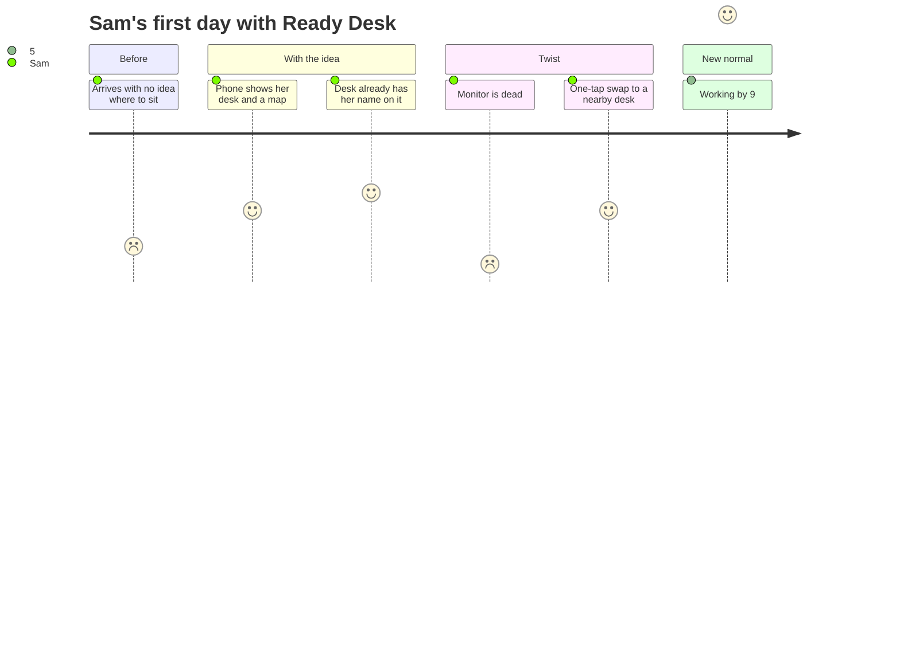

# Storyboard sketch formats: worked example

> **Hypothetical example.** It shows the formats only and is not real user research.

- **Idea:** "Ready Desk", from a hypothetical Big Idea Vignettes round
- **Character:** Sam, a new employee on her first day
- **Need:** new hires need to start working on day one without chasing IT and facilities

## 1. Panel script (excerpt)

### 1. Monday, 8:55, the lobby
- **We see:** Sam with a backpack in a busy lobby, checking her phone.
- **Thinks:** "Where am I even supposed to sit?"
- **Caption:** Today, a first day starts with waiting.

### 3. Twist: the monitor is dead
- **We see:** Sam at her desk. The monitor is dark. Action burst: "NOTHING."
- **Says:** "Of course."
- **Labels:** [Q] What happens when the assigned desk is broken?

### 4. One tap
- **We see:** Sam taps "swap desk" on her phone, and a map shows a free desk two rows over.
- **Thinks:** "Huh. That was easy."
- **Labels:** [A] Free desks are known in real time.

## 2. ASCII panels (quick look in the terminal)

```
+------------------------+------------------------+------------------------+
| 1. Lobby, 8:55         | 2. Desk is ready       | 3. Twist               |
|                        |                        |                        |
|   o   (Where do I      |   o/   "It has my      |   o    *NOTHING*       |
|  /|\   sit?)           |  /|     name on it!"   |  /|\   [====] dark     |
|  / \   [phone]         |  / \   [SAM]  [desk]   |  / \   "Of course."    |
|                        |                        |                        |
| Today, day one starts  | Her phone pointed her  | [Q] What if the desk   |
| with waiting.          | straight here.         | is broken?             |
+------------------------+------------------------+------------------------+
```

Keep each panel to roughly 24 characters wide and 3–4 panels per row so it renders in a terminal.

## 3. Mermaid emotional arc



Scores run from 1 (low) to 5 (high). The dip at the twist is what makes the story credible.

## 4. HTML comic strip skeleton

Save as `design-thinking/storyboards-<topic>.html`. It is self-contained, so it opens in any browser and prints cleanly for a Playback. Add one `.panel` per scene.

```html
<!doctype html>
<html lang="en"><head><meta charset="utf-8">
<meta name="viewport" content="width=device-width, initial-scale=1">
<title>Storyboard: Ready Desk</title>
<style>
  :root { --ink:#161616; --paper:#fff; --muted:#525252; --line:#8d8d8d; --tag:#fcf4d6; }
  @media (prefers-color-scheme: dark) { :root { --ink:#f4f4f4; --paper:#161616; --muted:#c6c6c6; --line:#6f6f6f; --tag:#3d3a1f; } }
  body { margin:0; padding:16px; background:var(--paper); color:var(--ink); font:15px/1.4 system-ui, sans-serif; }
  .strip { display:grid; grid-template-columns:repeat(auto-fit, minmax(220px, 1fr)); gap:12px; }
  .panel { border:2px solid var(--ink); border-radius:6px; padding:10px; display:flex; flex-direction:column; gap:6px; break-inside:avoid; }
  .num { font-weight:700; }
  .scene { color:var(--muted); font-style:italic; min-height:4em; }
  .say, .think { border:1.5px solid var(--line); border-radius:14px; padding:4px 10px; }
  .think { border-style:dashed; }
  .burst { font-weight:800; letter-spacing:.05em; }
  .caption { border-top:1px solid var(--line); padding-top:6px; font-size:13px; }
  .tag { background:var(--tag); font-size:12px; padding:2px 6px; border-radius:4px; }
</style></head><body>
<h1>Ready Desk: Sam's first day</h1>
<p><span class="tag">Hypothetical</span> Need: new hires can start working on day one.</p>
<div class="strip">
  <div class="panel">
    <div class="num">1 · Lobby, 8:55</div>
    <div class="scene">Sam in a busy lobby, checking her phone.</div>
    <div class="think">Where am I even supposed to sit?</div>
    <div class="caption">Today, day one starts with waiting.</div>
  </div>
  <div class="panel">
    <div class="num">3 · Twist</div>
    <div class="scene">Sam at her desk; the monitor is dark.</div>
    <div class="burst">NOTHING.</div>
    <div class="say">Of course.</div>
    <div class="tag">[Q] What if the assigned desk is broken?</div>
  </div>
</div>
</body></html>
```
