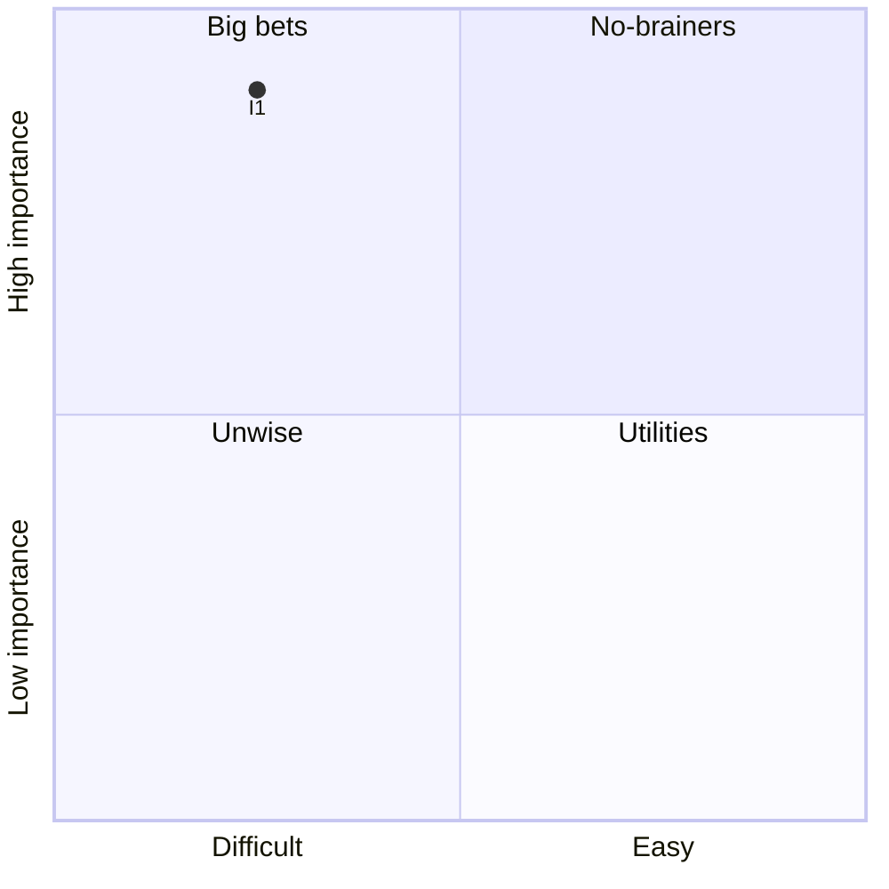

# Prioritization Grid

> IBM Enterprise Design Thinking · Plan your work · Reflect · ~30 min

Most teams judge ideas too early and too often, so they come up with fewer of them. The brain can barely create and evaluate at the same time. So create first. Then use the Prioritization Grid to reflect on the ideas together, through the lens of user value against feasibility, or against business value. The goal isn't a perfect ranking. It's a shared view of which ideas are obvious wins, which are worth a serious bet, and which to let go, so the team can decide what to do next.

## When to use it
- After an idea-generating activity, such as big idea vignettes, a to-be scenario map or storyboards, when the team must converge.
- When grooming a backlog of user stories before a sprint or release.
- When stakeholders disagree about what comes first and need to see the tradeoffs.

## Inputs
- Upstream artifacts in `design-thinking/`: `big-idea-vignettes-*`, `user-stories-*`, `to-be-scenario-map-*` and `storyboards-*` supply the ideas. `hills-*`, `needs-statements-*` and `empathy-map-*` inform importance. `assumptions-and-questions-*` informs risk.
- What to ask the user for if missing: the list of ideas, who the target user is, the team's capacity and constraints (skills, stack, deadlines, dependencies), and whether to use business value instead of feasibility.
- A grid is only as good as the ideas on it. If there are only a handful of ideas, or they're all variations of one, suggest `/edt-ideate:big-idea-vignettes` first.

## Co-create with Claude
1. **Bring the ideas.** List `design-thinking/` and collect the candidate ideas with their sources. Rewrite each as a one-line card that says what the user gets. Merge duplicates. Aim for roughly 8–25 distinct ideas.
2. **Set up the axes.** Agree on the definitions before scoring anything.
   - **Importance to the user**, from low to high: how much value the idea delivers to the target user. Anchor it to Hills and needs statements, not to how loudly a stakeholder asks.
   - **Feasibility for the team**, from difficult to easy: effort, skills, dependencies and technical risk.
   - Or **Business value** in place of feasibility, if the team chooses it.
3. **Evaluate quickly, one axis at a time.** Score every idea on importance first, then every idea on feasibility, so a high score on one axis doesn't color the other.
   - Use a rough 1–5 score with a one-line reason.
   - Tag each reason as **Evidence** (for example, a needs statement or a support-ticket count, with the source), **Assumption** or **Question**.
   - If the code for the product is in the working directory, you can look at it to inform feasibility. Label those estimates as Assumptions for the builders to confirm.
4. **Reposition relative to each other.** Show the plot and invite the user to challenge it with pairwise questions: "Is A really more valuable to the user than B?" If everything sits in the middle, force a spread. Relative position matters more than the numbers.
5. **Draw the focus areas.** Divide the grid into these zones:
   | Zone | Importance | Feasibility | What to do |
   | --- | --- | --- | --- |
   | **No-brainers** | High | Easy | Do them next |
   | **Big bets** | High | Mid to difficult | Big investments with potentially big payoffs, so discuss them |
   | **Utilities** | Low | Easy | Bundle them or do them when there's slack |
   | **Unwise** | Low | Difficult | Drop them, and say so |
6. **Focus the conversation on Big bets.** For each one, ask: why it's worth it, what makes it hard, what its riskiest assumption is, and what the smallest step to de-risk it would be.
7. **Decide and play back.** Record what happens next, what you'll invest in, what you'll bundle, and what you won't do. Then write the Playback section and save the artifact.

## Facilitate a live session
**Agenda (30 min)**
| Time | Step | What happens |
| --- | --- | --- |
| 0:00 | Intro | Create first, evaluate second. Confirm the axis definitions |
| 0:03 | Bring ideas | Post the idea stickies, merge duplicates, read each one aloud once |
| 0:08 | Set up | Draw the axes: Importance to the user (low to high) and Feasibility (difficult to easy) |
| 0:10 | Evaluate | Each person quickly places a share of the stickies, then the group discusses and repositions |
| 0:20 | Focus | Sketch the four zones on the grid and label them |
| 0:23 | Playback | Spend most of the time on Big bets, then confirm the No-brainers and the drops |

**Prompts to read aloud**
- "Importance means value to the user, not to us. Which need does this serve?"
- "Feasibility is for the people who'll build it to judge. Builders, does this placement look right?"
- "Which of these would we regret not doing in a year?"
- "What's the smallest thing we could do this sprint to find out if this Big bet pays off?"

**Materials:** the idea stickies, a large sheet or a Mural canvas, markers in two colors (one for axes, one for zones) and a timer.

**Board layout:** the vertical axis is Importance to the user, low at the bottom and high at the top. The horizontal axis is Feasibility, difficult on the left and easy on the right. No-brainers sit in the top-right corner. Big bets sit across the top toward the difficult side. Utilities are bottom right and Unwise is bottom left. Draw the zones as rough curved bands, not strict quadrants.

**After the session:** photograph or export the grid, then digitize each sticky's approximate position and zone into the Output template.

## Output
Save to `design-thinking/prioritization-grid-<topic>.md` using this template:

````markdown
# Prioritization Grid: <scope>
Axes: Importance to <user> × Feasibility for <team> (or Business value) · Date: <date>

## Ideas
| # | Idea (what the user gets) | Source | Importance 1–5 · why | Feasibility 1–5 · why | Zone |
| --- | --- | --- | --- | --- | --- |
| I1 | … | big-idea-vignettes-x.md | 5 · Evidence: needs-statements-x.md N2 | 2 · Assumption: needs new data pipeline | Big bet |

## Grid


## Big bets
| Bet | Why it's worth it | What makes it hard | Riskiest assumption | Smallest de-risking step |
| --- | --- | --- | --- | --- |

## Decisions
- Do next (No-brainers): …
- Invest in (Big bets): …
- Bundle or do when there's slack (Utilities): …
- Not doing (Unwise): …

## Playback
- Key takeaways: <3–5 bullets>
- Assumptions and questions to validate: …
- Next activity: …
````

Convert the 1–5 scores to 0–1 coordinates for the chart. Put feasibility on x and importance on y.

## Quality checks
- **Ideas were generated before evaluation.** Don't prune while you collect.
- **Importance reflects user value and cites a need or Hill.** Stakeholder volume, team excitement and "the competitor has it" don't count unless they're tied to a user need.
- **Feasibility is judged or confirmed by the people who'll build the idea.** Claude's estimates stay labelled as Assumptions.
- **The ideas are spread out.** If everything ends up "medium-medium", the team has avoided choosing.
- **Every Big bet has a riskiest assumption and a de-risking step.** A bet without a test is a gamble.
- **The Unwise list is written down and agreed.** Saying no out loud is half the value.
- **Each idea is one card about what the user gets,** not a bundle of features.

## Next
- `/edt-plan:experience-based-roadmap`: sequence the No-brainers and Big bets into stages.
- `/edt-plan:assumptions-and-questions`: dig into the riskiest assumptions behind the Big bets.
- `/edt-plan:user-stories`: break the chosen ideas into user tasks with acceptance criteria.
- `/edt-test:paper-prototypes`: test a Big bet cheaply before investing.
- `/edt-align:playbacks`: share the decisions with stakeholders.

## Source
[IBM Enterprise Design Thinking Toolkit: Prioritization Grid](https://www.ibm.com/downloads/documents/us-en/137a1e253e5bac05)
