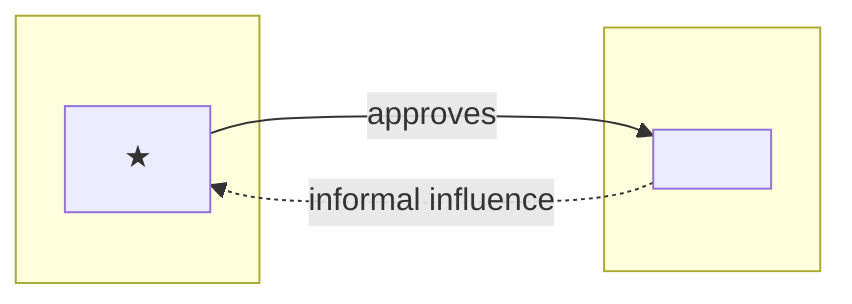

# Stakeholder Map

> IBM Enterprise Design Thinking · Synthesize research · Reflect · ~30 min

Work succeeds or stalls on people. A stakeholder map is the team reflecting together on who is involved with and affected by the project, what each of them expects, and how they relate to one another, so the team can communicate with them more effectively. It shows who decides, who influences, which relationships are strained, and who nobody thought to include. Often that last group is the end users and the people who support them. Done early, it gives the whole team a clear picture of who matters to this work.

## When to use it
- As early as possible on any new piece of work.
- At kickoff, or when a new teammate or sponsor joins.
- Before deciding who to interview, who to invite to Playbacks, or where to recruit Sponsor Users.
- When an initiative stalls and you suspect a missing, unheard or unhappy stakeholder.

## Inputs
- Upstream artifacts in `design-thinking/`:
  - **People:** `sponsor-users*`, `interviews*` (especially stakeholder interviews)
  - **Context:** `hopes-and-fears*`, `research-plan*`, `playbacks*`
  - **History:** earlier `stakeholder-map*` files
- Ask the user for anything still missing:
  - The project and its boundary
  - Any org charts, RACI tables, project docs or meeting attendee lists they can share
  - Who the end users are
  - What they know about the relationships
- Never invent named people. Where names aren't known, use roles. Expectations stay Assumptions until someone asks the stakeholder.

## Co-create with Claude
1. **Set up.** Name the project and its boundary. Decide on scope: internal teams, the client, users, and outside parties such as vendors, partners and regulators. On a wall you only need a blank space.
2. **Identify.** List everyone involved with or affected by the project, with their title if you know it. Prompt by category:
   - Who funds it?
   - Who decides?
   - Who builds it?
   - Who uses it?
   - Who supports or operates it?
   - Who is affected downstream?
   - Who can block it (legal, security, procurement)?
   - Who is outside the organization?

   Note where each name came from: an org chart, a meeting, or the user's own knowledge.
3. **Cluster.** As groups surface, cluster them and label each one, for example *Finance*, *Platform team*, *Client IT* or *Patients and families*.
4. **Connect.** Draw the relationships. Ask how they depend on each other and how they interact. For every line, record:
   - **The direction and the verb,** for example *approves*, *funds*, *hands off to*, *is first contact for*.
   - **The quality:** good (+), strained (−) or unknown (?).

   Mark decision-makers and influencers with ★. For each key stakeholder, add what they expect from the work and what they care about, tagged.
5. **Playback.** Describe the stakeholders' goals and relationships as a short story, then list the unknowns that remain. Suggest concrete engagement actions: who to talk to, who to invite, and who to keep informed.

## Facilitate a live session
**Agenda (30 min)**
- **0–3:** Intro. Explain why you're doing this and the norms: write before you talk, everyone participates, use a parking lot.
- **3–5:** Setup. Write the project name in the middle of a blank wall or canvas.
- **5–13:** Identify. Everyone writes silently, one stakeholder per sticky note, with a name or role and a title.
- **13–18:** Cluster. Group the notes and label the groups as they surface.
- **18–26:** Connect. Draw lines and arrows, label them with verbs, and add the legend symbols.
- **26–30:** Playback. One person walks through goals and relationships, and the team lists the unknowns.

**Prompts to read aloud**
- "Who is involved in this work? Who is affected by it, even indirectly?"
- "Who can say yes? Who can say no? Who gets the blame if it fails?"
- "Who uses the result every day, and who supports them?"
- "How do these two depend on each other? How do they interact?"
- "Who is missing from this wall?"

**Materials:** a blank wall or canvas, sticky notes, markers, and a legend drawn in one corner.

**Board layout (wall or Mural):**
- **Center:** the project.
- **Around it:** stakeholder notes in labeled cluster circles.
- **Lines:** solid arrows for formal dependencies and dashed lines for informal influence, each labeled with a verb.
- **Legend:** ★ decision-maker or influencer · + good relationship · − strained relationship · ? unknown.
- **Corner:** a parking lot.

**Afterwards:** give Claude a photo of the wall or the Mural export, and Claude digitizes it into the template below.

## Output
Save to `design-thinking/stakeholder-map-<topic>.md` using this template:

````markdown
# Stakeholder Map: <project>

**Scope:** … · **Contributors:** … · **Date:** … · **Sharing:** team only / shareable

## Stakeholders
### <Group label>
| Stakeholder (name or role) | Title | Involved / impacted | ★ | Expects from this work | Tag |
|---|---|---|---|---|---|
| … | … | … | … | … | Evidence: <source> / Assumption |

## Relationships
| From | Verb | To | Quality (+ / − / ?) | Tag |
|---|---|---|---|---|

## Diagram


## Unknowns
- …. Question

## Engagement plan
| Stakeholder | Why they matter | Next touchpoint (interview, Playback, update) | Owner |
|---|---|---|---|

## Parking lot
- …

## Playback
- **Key takeaways (3–5):** …
- **Assumptions and questions to validate:** …
- **Recommended next activity:** `/edt-align:hopes-and-fears`
````

## Quality checks
- The map includes the people the work is *for* (end users and the people around them), not only senior names from the org chart.
- Every stakeholder has a role or title, and every group is labeled.
- Decision-makers and influencers are marked, and the approval path is visible. Influence is not assumed from seniority.
- Each relationship line says *how* the two depend on or interact with each other, with a verb, not just a line.
- Key stakeholders have recorded expectations. Most are Assumptions until someone asks them, and they're tagged that way.
- Unknowns are listed, and each one leads to an engagement action.
- The map is fit to share. Relationship ratings are about real colleagues, so keep the wording factual and respectful. Keep sensitive notes out of shared files, or describe people by role.
- Pitfalls:
  - Mapping only the immediate team
  - Treating "the client" as a single stakeholder
  - Drawing lines with no meaning
  - Never updating the map as people change

## Next
- `/edt-align:hopes-and-fears`: hear stakeholders' expectations directly at kickoff.
- `/edt-align:playbacks`: use the map to build the invite list and tailor the story.
- `/edt-core:sponsor-users`: recruit Sponsor Users from the user groups on the map.
- `/edt-gather:interviews`: interview key stakeholders to replace assumed expectations with evidence.
- `/edt-plan:research-plan`: decide who to research, and in what order.
- `/edt-core:workshop-planner`: plan who to bring to the next workshop.

## Source
[IBM Enterprise Design Thinking Toolkit: Stakeholder Map](https://www.ibm.com/downloads/documents/us-en/137a3e34823ed9ae)
